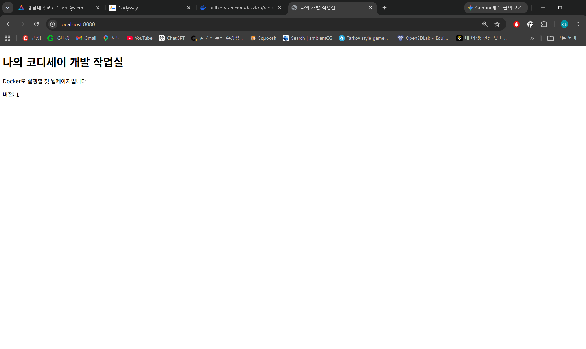
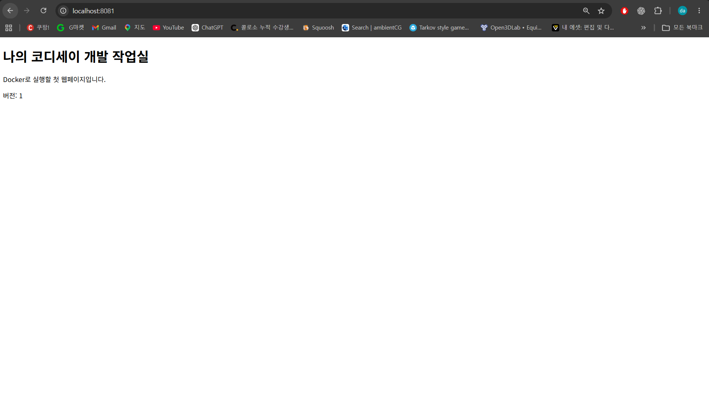
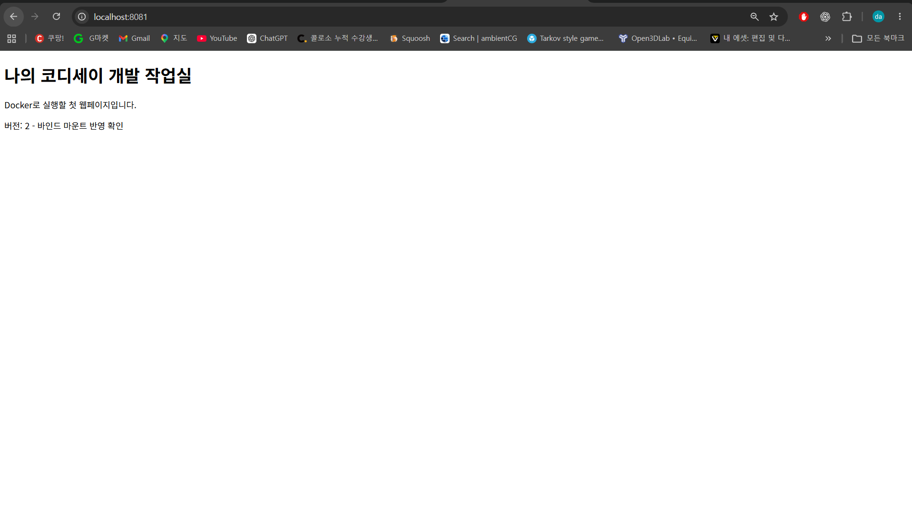
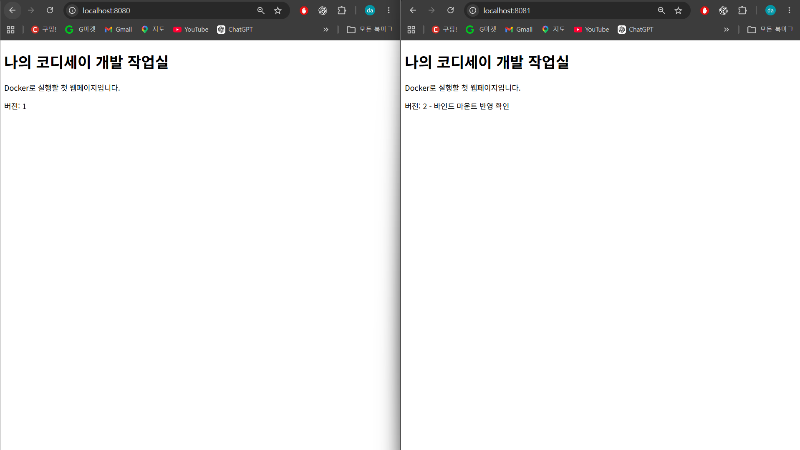
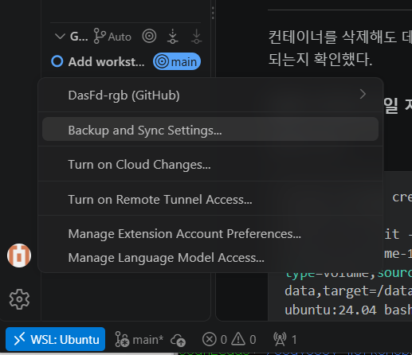
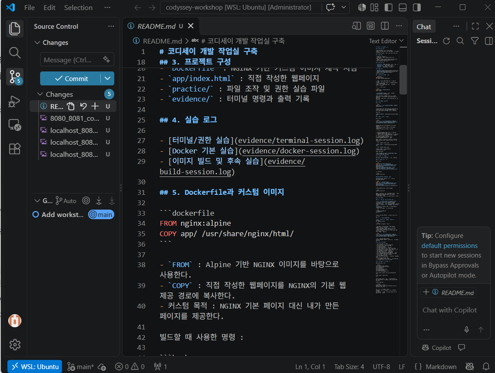

# 코디세이 E1-1 | 개발 작업실 구축

## 1. 프로젝트 개요

리눅스 터미널에서 파일과 권한을 다루고,
Docker로 웹 서버를 실행한 뒤 포트 매핑과 저장 공간을 검증했다.
Git으로 작업 이력을 관리하고 수행 결과를 기록한다.

## 2. 실행 환경

- 호스트 OS : Windows 11
- 리눅스 환경 : WSL2 / Ubuntu 26.04.1 LTS
- 셸 : bash
- 터미널 : Windows PowerShell에서 WSL Ubuntu 실행
- Docker : Docker Desktop / Engine 29.9.2
- Git : Ubuntu 내 Git 2.53.0

## 3. 프로젝트 구성

- `Dockerfile` : NGINX 기반 커스텀 이미지 제작 지침
- `app/index.html` : 직접 작성한 웹페이지
- `practice/` : 파일 조작 및 권한 실습 파일
- `evidence/` : 터미널 명령과 출력 기록

## 4. 실습 로그

- [터미널/권한 실습](evidence/terminal-session.log)
- [Docker 기본 실습](evidence/docker-session.log)
- [이미지 빌드 및 후속 실습](evidence/build-session.log)

## 5. Dockerfile과 커스텀 이미지

```dockerfile
FROM nginx:alpine
COPY app/ /usr/share/nginx/html/
```

- `FROM` : Alpine 기반 NGINX 이미지를 바탕으로 사용한다.
- `COPY` : 직접 작성한 웹페이지를 NGINX의 기본 웹 제공 경로에 복사한다.
- 커스텀 목적 : NGINX 기본 페이지 대신 내가 만든 페이지를 제공한다.

빌드할 때 사용한 명령 :

```bash
docker build -t codyssey-web:1.0 .
docker images
```

빌드가 FINISHED로 완료됐고, 이미지 목록에서
`codyssey-web:1.0`을 확인했다.

주의 : 최초 이미지는 버전 1 페이지로 빌드했다.
이후 바인드 마운트 실습에서 원본 HTML을 버전 2로 수정했다.
따라서 현재 소스로 다시 빌드하면 버전 2가 이미지에 포함된다.

## 6. 포트 매핑과 접속 확인

실행한 명령 :

```bash
docker run -d --name codyssey-web-8080 -p 8080:80 codyssey-web:1.0
```

호스트의 8080 포트를 컨테이너의 80 포트에 연결했다.
브라우저에서 http://localhost:8080 에 접속하여
직접 작성한 웹페이지와 '버전: 1'문구를 확인했다.

접속 증거 :



## 7. 바인드 마운트 변경 반영

실행한 명령 :

```bash
docker run -d --name codyssey-bind -p 8081:80 --mount type=bind,source="$(pwd)/app",target=/usr/share/nginx/html,readonly codyssey-web:1.0
```

호스트의 app 폴더를 컨테이너의 웹 제공 경로에 연결했다.
readonly는 컨테이너에서 연결된 파일을 수정하지 못하게 한다.
호스트에서는 원본 파일을 수정할 수 있다.

검증 절차 :

1. localhost:8081에서 버전 1 페이지를 확인했다.
2. 호스트의 app/index.html 문구를
	'버전 2 - 바인드 마운트 반영 확인'으로 수정했다.
3. 이미지를 다시 빌드하거나 컨테이너를 재시작하지 않고 브라우저를 새로고침했다.
4. localhost:8081에는 버전 2가 표시됐고, localhost:8080에는 버전 1이 유지됐다.

결론 : COPY는 빌드 당시의 파일을 이미지에 복사하고,
바인드 마운트는 연결된 호스트 폴더의 현재 파일을 제공한다.

변경 전 - 8081에서 버전 1 확인 :



변경 후 - 8081에서 버전 2 확인 :



8080과 8081 비교 :



## 8. Docker 볼륨 영속성 검증

컨테이너를 삭제해도 데이터가 유지되는지 확인했다.

### 볼륨 생성과 파일 저장

실행한 명령 :

```bash
docker volume create codyssey-data
docker run -dit --name codyssey-volume-1 --mount type=volume,source=codyssey-data,target=/data ubuntu:24.04 bash
docker exec codyssey-volume-1 bash -c 'echo "Codyssey volume test" > /data/hello.txt'
docker exec codyssey-volume-1 cat /data/hello.txt
```

파일 확인 결과

```text
Codyssey volume test
```

### 컨테이너 삭제 후 데이터 재확인

첫 번째 컨테이너만 삭제하고, 같은 볼륨을 새 컨테이너에 연결했다.

```bash
docker rm -f codyssey-volume-1
docker run -dit --name codyssey-volume-2 --mount type=volume,source=codyssey-data,target=/data ubuntu:24.04 bash
docker exec codyssey-volume-2 cat /data/hello.txt
```

새 컨테이너에서도 다음 내용이 출력됐다.

```text
Codyssey volume test
```

결론 : 파일을 다시 만들지 않았는데도 내용이 유지됐다.
데이터가 컨테이너의 쓰기 계층이 아닌 별도의 codyssey-data 볼륨에
저장되어 있기 때문이다. 볼륨 자체는 삭제하지 않았다.

## 9. 트러블슈팅

### 사례 1. 존재하지 않는 파일 삭제 시도

- 문제 : `rm rename.txt`와 `rm renamed.txt`에서
`No such file or directory` 오류가 발생했다.
- 원인 가설 : 삭제할 파일 이름이 잘못됐거나,
아직 해당 이름으로 변경하지 않았을 수 있다고 생각했다.
- 확인 : 앞서 실행한 `ls -la`결과에는 `copy.txt`가 있었고,
`renamed.txt`는 없었다. 이름 변경 명령을 빠뜨린 것을 확인했다.
- 해결 : 파일 이름을 변경한 뒤 삭제했다.

```bash
mv copy.txt renamed.txt
rm renamed.txt
ls -la
```

- 결과 : 오류 없이 삭제됐고, 목록에서 해당 파일이 사라졌다.

### 사례 2. --mount 설정값 누락

- 문제 : `docker run ` 명령을 `--mount`까지만 입력하자
다음 오류가 발생했다.

```text
flag needs an argument: --mount
```

- 원인 가설: `--mount`에 필요한 연결 설정값이
빠졌기 때문이라고 생각했다.
- 확인 : 도움말의 `--mount mount`는 옵션 뒤에
마운트 설정값이 필요하다는 뜻이었다.
- 해결 : 마운트 유형, 원본 경로, 연결 위치와 읽기 전용 설정을 지정하고
이미지 이름까지 입력했다.

```bash
docker run -d --name codyssey-bind -p 8081:80 --mount type=bind,source="$(pwd)/app",target=/usr/share/nginx/html,readonly codyssey-web:1.0
```

- 결과 : 컨테이너 ID가 출력됐고,
localhost:8081에서 웹페이지 접속과 파일 변경 반영을 확인했다.

## 10. 수행 체크리스트

- [x] 터미널 기본 파일 조작
- [x] 파일/디렉토리 권한 변경 전후 확인
- [x] Docker 버전 및 엔진 동작 확인
- [x] hello-world 실행
- [x] Ubuntu 컨테이너 내부 명령 실행
- [x] 이미지/컨테이너 목록, 로그, 리소스 확인
- [x] 컨테이너 중지/재시작과 attach/exec 차이 관찰
- [x] Dockerfile 직접 작성 및 커스텀 이미지 빌드
- [x] 포트 매핑 및 브라우저 접속 확인
- [x] 바인드 마운트 파일 변경 반영 확인
- [x] 볼륨의 컨테이너 삭제 전후 데이터 유지 확인
- [x] Git 작성자 이름/이메일과 기본 브랜치 설정
- [x] 로컬 Git 저장소 생성 및 첫 커밋
- [x] 트러블슈팅 2건 기록
- [x] 접속/마운트 비교 캡처를 저장소에 넣고 README에 연결
- [x] Git 설정 확인 결과 기록
- [x] VS Code에서 Github 로그인 및 저장소 연동 확인
- [x] GitHub 업로드 및 제출 링크 확인

## 11. Git 설정 및 로컬 버전 관리

설정 확인 명령과 출력 :

```console
$ git config --list --local
core.repositoryformatversion=0
core.filemode=true
core.bare=false
core.logallrefupdates=true
user.name=DasFd-rgb
user.email=cedn2015@gmail.com

$ git config --global --get init.defaultBranch
main

$ git branch --show-current
main
```

작성자 이름과 이메일은 현재 저장소에 설정했다.
새 저장소의 기본 브랜치와 현재 작업 브랜치는 모두 main이다.

첫 커밋 확인 결과 :

```console
$ git log -1 --oneline
5647024 (HEAD -> main) Add workstation practice and Docker web server
```

Git은 로컬 변경 이력을 관리하고,
GitHub는 저장소를 온라인에서 공유하고 협업하는 서비스다.
VS Code에서 DasFd-rgb GitHub 로그인을 확인했다.
origin에 과제 저장소 주소를 등록하고,
git push -u origin main으로 두 커밋을 업로드했다.


## 12. 핵심 수행 로그와 개념 설명

아래는 본인이 수행한 터미널 기록에서 발췌한 명령과 결과다. 긴 목록은 일부 행만 발췌했으며,
터미널 제어 문자와 입력 중 수정 흔적은 읽기 쉽게 정리했다. 원본 기록은 4절 링크에 보관했다.
전체 작업을 대신한 예시 출력이 아니라 기존 실습 결과의 요약이다.

### 터미널 기본 조작

```console
$ pwd
/home/cedn2/codyssey-workshop
$ mkdir -p practice
$ cd practice
$ touch empty.txt
$ echo "Hello Codyssey" > original.txt
$ cp original.txt copy.txt
$ touch .hidden-example
$ ls -la
# 목록 중 파일 행 발췌
-rw-r--r-- 1 cedn2 cedn2    0 Nov  3 12:55 .hidden-example
-rw-r--r-- 1 cedn2 cedn2   15 Nov  3 12:55 copy.txt
-rw-r--r-- 1 cedn2 cedn2    0 Nov  3 12:55 empty.txt
-rw-r--r-- 1 cedn2 cedn2   15 Nov  3 12:55 original.txt
$ cat original.txt
Hello Codyssey
$ mv copy.txt renamed.txt
$ rm renamed.txt
$ ls -la
# 삭제 후 파일 행 발췌: renamed.txt는 없음
-rw-r--r-- 1 cedn2 cedn2    0 Nov  3 12:55 .hidden-example
-rw-r--r-- 1 cedn2 cedn2    0 Nov  3 12:55 empty.txt
-rw-r--r-- 1 cedn2 cedn2   15 Nov  3 12:55 original.txt
$ cd ..
```

- 절대 경로: `/home/cedn2/codyssey-workshop/app/index.html`처럼 루트 `/`부터 나타낸 주소.
- 상대 경로: 과제 폴더에서의 `app/index.html`처럼 현재 위치를 기준으로 한 주소.
- `~`는 현재 사용자의 홈 경로다. 다른 PC에서는 사용자 이름이 달라도 `~/codyssey-workshop`을 사용할 수 있다.
- `mkdir`는 폴더 생성, `touch`는 빈 파일 생성(기존 파일이면 시간 갱신), `cp`는 복사,
  `mv`는 이동/이름 변경, `rm`은 삭제, `cat`은 내용 확인이다.
- `ls -la`는 숨김 파일을 포함해 상세 목록을 보여준다. `cd ..`는 상위 폴더 이동이다.

### 파일 및 디렉토리 권한 전후

```console
$ echo "permission practice" > practice/permission.txt
$ mkdir -p practice/permission-dir
$ chmod 600 practice/permission.txt
$ chmod 700 practice/permission-dir
$ ls -ld practice/permission.txt practice/permission-dir
drwx------ 2 cedn2 cedn2 4096 Nov  3 12:59 practice/permission-dir
-rw------- 1 cedn2 cedn2   20 Nov  3 12:59 practice/permission.txt
$ chmod 644 practice/permission.txt
$ chmod 755 practice/permission-dir
$ ls -ld practice/permission.txt practice/permission-dir
drwxr-xr-x 2 cedn2 cedn2 4096 Nov  3 12:59 practice/permission-dir
-rw-r--r-- 1 cedn2 cedn2   20 Nov  3 12:59 practice/permission.txt
```

권한 숫자는 소유자/그룹/기타 사용자 순서로, r=4, w=2, x=1을 더한다.
644는 `rw-/r--/r--`, 755는 `rwx/r-x/r-x`다.
파일의 r/w/x는 읽기/쓰기/실행이다. 디렉토리의 r은 이름 목록 읽기,
w는 항목 생성·삭제·이름 변경, x는 경로 탐색과 내부 접근이다. 실제 작업에는 권한 조합이 영향을 준다.
Git은 일반 Unix 권한 전체를 보존하지 않고 파일 실행 비트 등을 기록하므로 권한 실습은 위 명령으로 재현한다.
빈 디렉토리도 Git이 추적하지 않으므로 `permission-dir`은 재현 시 생성한다.

### Docker 설치 점검과 기본 운영

```console
$ docker --version
Docker version 29.9.2, build a82e528
$ docker info
# 최초 점검 출력 중 발췌
Server Version: 29.9.2
Operating System: Docker Desktop
OSType: linux
Architecture: x86_64
$ docker run --name codyssey-hello hello-world
# 출력 중 핵심 행
Hello from Docker!
$ docker pull ubuntu:24.04
# 출력 중 핵심 행
Status: Downloaded newer image for ubuntu:24.04
$ docker images
# 최초 다운로드 후 목록에서 확인한 이미지
hello-world:latest
ubuntu:24.04
$ docker logs codyssey-hello
# 출력 중 핵심 행
Hello from Docker!
$ docker stats --no-stream codyssey-ubuntu
CONTAINER ID   NAME              CPU %     MEM USAGE / LIMIT     MEM %     NET I/O         BLOCK I/O    PIDS
c594f9e7fbed   codyssey-ubuntu   0.00%     1.941MiB / 15.28GiB   0.01%     1.17kB / 126B   0B / 4.1kB   1
```

`--version`은 클라이언트 버전, `info`는 엔진 연결 상태를 확인한다.
`images`는 이미지 목록, `ps`는 실행 중, `ps -a`는 중지된 컨테이너까지 확인한다.
`logs`는 수집된 표준 출력/오류, `stats --no-stream`은 한 시점의 리소스 사용량을 보여준다.
이미지는 실행에 필요한 파일·설정의 바탕이며, 컨테이너는 그 이미지로 만든 실행 단위다.

### Ubuntu 내부 진입, 중지/재시작, exec/attach 관찰

```console
$ docker run -dit --name codyssey-ubuntu ubuntu:24.04 bash
c594f9e7fbed0a84bf43b6147275517a5dd59a89b981f92400d05a68c14410b2
$ docker exec -it codyssey-ubuntu bash
root@c594f9e7fbed:/# ls
bin  boot  dev  etc  home  lib  lib64  media  mnt  opt  proc  root  run  sbin  srv  sys  tmp  usr  var
root@c594f9e7fbed:/# echo "Hello from Ubuntu container"
Hello from Ubuntu container
root@c594f9e7fbed:/# exit
exit
$ docker ps
# codyssey-ubuntu의 STATUS: Up About a minute
$ docker stop codyssey-ubuntu
codyssey-ubuntu
$ docker ps -a
# codyssey-ubuntu의 STATUS: Exited (137)
$ docker start codyssey-ubuntu
codyssey-ubuntu
$ docker ps
# codyssey-ubuntu의 STATUS: Up 2 seconds
$ docker attach codyssey-ubuntu
root@c594f9e7fbed:/# echo "Attached to the main shell"
Attached to the main shell
root@c594f9e7fbed:/# exit
exit
$ docker ps -a
# codyssey-ubuntu의 STATUS: Exited (0)
```

`exec`는 별도의 프로세스를 시작하므로 그 셸에서 exit해도 원래 bash가 남아 컨테이너가 유지됐다.
`attach`는 기존 주 프로세스에 연결하므로 그 bash에서 exit하자 컨테이너도 정상 종료됐다.
중간의 종료 코드 137은 SIGKILL 종료에 해당한다. stop의 대기 시간 초과 가능성이 있으나 원인은 단정하지 않는다.

## 13. VS Code와 GitHub 연동 증거

VS Code 계정 메뉴의 `DasFd-rgb (GitHub)`와 `WSL: Ubuntu` 표시를 확인했다.
소스 제어 화면에서 main 브랜치, 기존 커밋, 새 README 및 사진이 인식됐다.
아래 이미지는 실제 실습 중 저장한 화면이며 로그인과 로컬 저장소 인식을 각각 증명한다.





```console
$ git remote -v
origin  https://github.com/DasFd-rgb/codyssey-e1-1-workstation.git (fetch)
origin  https://github.com/DasFd-rgb/codyssey-e1-1-workstation.git (push)
$ git push -u origin main
# 최초 업로드 결과 발췌
 * [new branch]      main -> main
branch 'main' set up to track 'origin/main'
$ git push
# README 후속 수정 업로드 결과 발췌
   4f3d49c..1331bec  main -> main
$ git status
On branch main
Your branch is up to date with 'origin/main'.

nothing to commit, working tree clean
```

위 커밋 번호와 출력은 제출 문서 보완 이전 실습 시점의 결과이며, 이후 문서 보완 커밋이 추가된다.
Git 작성자 정보 설정, VS Code 계정 로그인, 원격 주소 등록, push 성공은 각각 별도의 확인 항목이다.

## 14. 평가자용 재현 절차

### 준비 조건

- Docker 엔진이 동작하고 Git, Bash, curl을 사용할 수 있는 Linux/WSL2 환경.
- Windows에서는 Docker Desktop의 Ubuntu WSL Integration을 활성화한다.
- 호스트 포트 18080/18081이 비어 있어야 한다. 사용 중이면 `-p` 왼쪽 숫자와 접속 주소를 함께 바꾼다.
- 아래 `review-*` 이름이 이미 있다면 다른 이름으로 통일해 사용한다.
- 브라우저는 Windows에서 열어도 된다. 최초 빌드에는 이미지 다운로드 네트워크 연결이 필요하다.

### 웹 빌드 및 마운트 비교 재현

현재 제출 원본은 버전 2다. 기존 사진의 버전 1→2 비교를 재현하려면 별도 연습 사본에서
먼저 버전 1로 바꿔 빌드하고, 실행 후 호스트 파일만 버전 2로 바꾼다. 제출 원본은 보존한다.

```bash
git clone https://github.com/DasFd-rgb/codyssey-e1-1-workstation.git
cd codyssey-e1-1-workstation
mkdir -p review-context/app
cp Dockerfile review-context/Dockerfile
cp app/index.html review-context/app/index.html
nano review-context/app/index.html
```

위 사본의 버전 문단을 `<p>버전: 1</p>`로 저장한 뒤 실행한다.

```bash
docker build -t review-web:1.0 review-context
docker run -d --name review-web -p 127.0.0.1:18080:80 review-web:1.0
docker run -d --name review-bind -p 127.0.0.1:18081:80 --mount type=bind,source="$(pwd)/review-context/app",target=/usr/share/nginx/html,readonly review-web:1.0
curl -fsS http://localhost:18080
curl -fsS http://localhost:18081
```

두 응답에서 버전 1을 확인한다. 이제 `nano review-context/app/index.html`로 문단을
`<p>버전: 2 - 바인드 마운트 반영 확인</p>`로 바꾸고 저장한다.

```bash
curl -fsS http://localhost:18080
curl -fsS http://localhost:18081
docker logs review-web
docker stats --no-stream review-web review-bind
```

예상 결과: 18080은 버전 1, 18081은 버전 2. 이미지 재빌드와 컨테이너 재시작 없이 확인한다.
브라우저로 두 주소를 열어 주소창과 페이지를 함께 확인할 수 있다.
포트 매핑은 호스트 포트로 들어온 요청을 컨테이너의 80 포트로 전달한다.
Dockerfile의 EXPOSE만으로 호스트에 포트가 공개되지는 않는다.

### 이름 있는 볼륨 재현

```bash
docker volume create review-data
docker run -dit --name review-volume-1 --mount type=volume,source=review-data,target=/data ubuntu:24.04 bash
docker exec review-volume-1 bash -c 'echo "Codyssey volume test" > /data/hello.txt'
docker exec review-volume-1 cat /data/hello.txt
docker rm -f review-volume-1
docker run -dit --name review-volume-2 --mount type=volume,source=review-data,target=/data ubuntu:24.04 bash
docker exec review-volume-2 cat /data/hello.txt
```

삭제 전후 모두 `Codyssey volume test`가 출력되어야 한다. 새 컨테이너에서는 파일을 다시 쓰지 않는다.
바인드 마운트는 지정한 호스트 경로, 이름 있는 볼륨은 Docker가 관리하는 저장 공간을 연결한다.

### 연습 자원 정리 (위 재현에서 만든 대상만)

```bash
docker rm -f review-web review-bind review-volume-2
docker volume rm review-data
docker image rm review-web:1.0
```

마지막 volume rm은 연습 데이터를 삭제하므로 데이터 확인을 마친 뒤에만 수행한다.
`review-context` 사본은 필요에 따라 직접 보관 또는 정리한다.
권한·터미널 실습은 12절 명령을 별도의 빈 연습 폴더에서 수행한다.

## 15. 제출 전 재검증 및 범위

- [제출 전 보조 검증의 실제 명령·출력](evidence/final-verification.txt)
- 별도 임시 사본과 별도 이름의 검증용 컨테이너로 빌드·포트·변경 전후·볼륨 영속성을 재확인했다.
- 위 로그의 제출 전 자동 점검은 본인이 수행한 원본 실습 로그와 구분한다.
- 원본 HTML, 기존 실습 컨테이너와 codyssey-data 볼륨은 보존했다.
- Compose와 SSH는 선택 과제이므로 이번 필수 제출 범위에는 포함하지 않는다.
- 원본 터미널 로그에는 편집기의 화면 제어 문자와 입력 수정 흔적이 있어 12절에 핵심 결과를 별도로 정리했다.
- 제출 링크: https://github.com/DasFd-rgb/codyssey-e1-1-workstation
